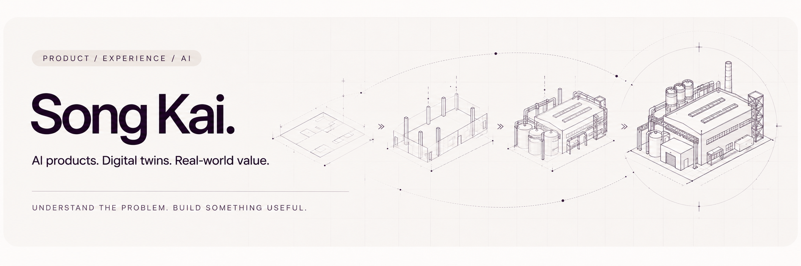

  <a href="https://caliwon2077.github.io/editorial.html">个人网站</a> ·
  <a href="#项目与实践">项目与实践</a> ·
  <a href="#文章与思考">文章与思考</a> ·
  <a href="mailto:caliwon@qq.com">联系我</a>

---

## 关于我

你好，我是宋凯。我有**程序开发、动画制作、项目管理与产品管理**的工作经历，逐渐形成了兼顾技术实现、视觉表达、用户体验与商业价值的工作方式。

我的主要实践领域是**工业数字化、三维可视化、数字孪生与交互式应用**。参与过能源装备、工业生产、设备运维及虚拟仿真培训等方向的项目，工作覆盖需求分析、产品规划、交互设计、技术方案制定、跨团队协作与项目交付。

我习惯从业务场景出发，拆解复杂需求，在技术、体验、成本与交付效率之间寻找合理平衡。我也喜欢游戏，对交互体验、视觉设计和新技术保持长期兴趣。

> **理解业务，尊重技术，关注体验，重视落地。**

## 专业方向与技能

| 方向 | 能力与实践 |
| --- | --- |
| **产品设计与项目管理** | 需求分析、产品架构、交互原型、技术选型、任务拆解、跨团队协作与项目交付 |
| **三维可视化与数字孪生** | 工业场景可视化、三维交互、虚拟仿真、设备数字化与可视化平台建设 |
| **AI 产品应用** | 大语言模型、RAG、Agent、知识库、AI 工作流及智能业务系统设计 |
| **技术与创意协同** | 三维引擎、Web 技术、动画与视觉表达、交互设计、跨专业团队协作 |

**三维技术关注**

  
  
  
  

**AI 应用探索**

  
  
  
  
  
  

**场景与方法**

  
  
  
  
  
  
  

持续探索三维技术、人工智能与产品设计的交叉领域，研究如何将 AI 与传统业务系统有效结合。

## 项目与实践

<table>
  <tr>
    <td width="50%" valign="top">
      <h3><a href="https://github.com/caliwon2077/matplotlib">matplotlib</a> Public</h3>
      
Forked from <a href="https://github.com/matplotlib/matplotlib">matplotlib/matplotlib</a>

      
matplotlib: plotting with Python

      
 🔵 Python

    </td>
    <td width="50%" valign="top">
      <h3><a href="https://github.com/caliwon2077/pixelfx_effect">pixelfx_effect</a> Public</h3>
      
Forked from <a href="https://github.com/patch-gg/pixelfx">patch-gg/pixelfx</a>

      
244 pixel art effects, every one a small piece of code. Plus a Claude Code skill to make your own.

      
🟡 JavaScript

    </td>
  </tr>
  <tr>
    <td colspan="2" valign="top">
      <h3><a href="https://github.com/caliwon2077/willowbrook-cattery">willowbrook-cattery</a> Public</h3>
      
Willowbrook 猫舍互动单页展示 · Interactive cattery landing page

      
🟡 JavaScript

    </td>
  </tr>
</table>

## 文章与思考

<!-- ARTICLES:START -->
围绕 AI 产品、三维技术、工作方式与软件落地，记录观察、思考和实践。

[打开完整文章库](https://my.feishu.cn/wiki/ZHLCw0XXxiXcmRk0KnecFuG9n5b) · [微信阅读入口](https://mp.weixin.qq.com/s/faHKaorbYBzXaai--6A-1w)

### AI 产品与工作方式

- [传统软件 vs AI 软件深度拆解：狂欢背后，究竟谁在裸泳？](https://my.feishu.cn/wiki/SCe1wgsy7ipJt4kt2mKcwpbtnqc)
- [你去开会，AI继续干活：新一代助手开始学着“接任务”](https://my.feishu.cn/wiki/EMCRwfbWHi8lRIkJHQvc3ISInSb)
- [AI帮你写完了，然后呢？这次，Gemini把“改文件”也接上了](https://my.feishu.cn/wiki/Q9u0waL9ViLvDqkzXaqcRG0hnCe)
- [告别抢鼠标！AI 浏览器黑马 ego (lite) 深度开箱：打工人与多 Agent 并行的“摸鱼神级装备”](https://my.feishu.cn/wiki/MTbPwMrzVixbqwk7AeHcXPG3nue)
- [领导用豆包下指标，我用豆包写汇报，领导再用豆包审？打工人靠“白色小字”求AI放过到底管不管用](https://my.feishu.cn/wiki/D4oIwShariaMRLk0UGFcpo7Snfb)

### 知识库与三维技术

- [别被大模型忽悠了！为什么光有LLM不够，你还得给它配个“私人图书管理员”（RAG）？](https://my.feishu.cn/wiki/M4GGwwvEyiryafkbWJzcj1c9nQh)
- [【神器安利】别再死磕建模和手搓动作了！两个让打工人直呼“真香”的 3D 开源宝藏](https://my.feishu.cn/wiki/SZltwEKx5iH4jSkKSkKc6gyPn5e)

### 行业观察与技术热点

- [信创深水区的隐痛：当“达标的硬件”遇上“苛刻的甲方”，谁在倒逼软件生态内耗？](https://my.feishu.cn/wiki/QlvOwm22Iis1Akka9YscN52ansb)
- [全网紧急“拔网线”！AI挖出潜伏14年的PHP大雷，今天用大白话带你吃透这个科技大瓜🔥](https://my.feishu.cn/wiki/AdQTwfrdai7stfkgcsJc3APanvb)

飞书文章保留原有访问权限；如出现登录或申请访问提示，请按文档页面提示操作。
<!-- ARTICLES:END -->

## 与我交流

欢迎交流 **AI 产品、数字孪生、工业可视化、交互体验，以及值得落地的新想法**。

- **个人网站**：[caliwon2077.github.io](https://caliwon2077.github.io/editorial.html)
- **邮箱**：[caliwon@qq.com](mailto:caliwon@qq.com)
- **GitHub**：[@caliwon2077](https://github.com/caliwon2077)

---

保持好奇，持续构建。让技术价值，落到真实的使用价值。

